---

## About

I'm a **Backend Developer working at the intersection of Python, distributed systems, and applied AI**. I build APIs, integrations, and AI-powered workflows, with a focus on making systems useful, reliable, and maintainable.

- Currently: **Junior Python Developer at CallBotics** (Nov 2025 – Present)
- Focus: Backend engineering, LLM tool calling, AI agents, integrations, and async systems
- Education: **B.Tech in Computer Science**, MIT World Peace University, Pune (2021–2025) · CGPA: **8.83/10**
- Interested in: Backend / Python Engineering and Applied AI Engineering opportunities

## Experience

### Junior Python Developer · CallBotics
*Nov 2025 – Present*

- Work across Voice AI, Chat AI, and Agent Assist product workflows.
- Build and maintain LLM tool-calling flows and integrations with external business systems.
- Develop modular connectors for CRM and cloud services, including HubSpot, Salesforce, Google Drive, Dropbox, and AWS S3.
- Work on asynchronous Python workflows and backend integrations.
- Integrated Google Speech-to-Text into the Voice AI pipeline.

### Backend Developer Intern · Black Cherie Media
*Jan 2024 – Jan 2025*

- Built and maintained **100+ REST API endpoints** using Node.js and Express for a digital-media SaaS platform serving **10,000+ daily users**.
- Improved MongoDB query performance from approximately **900 ms to 550 ms** through indexing and query optimization.
- Implemented OAuth 2.0, JWT authentication, and role-based access control.
- Worked with AWS Lambda, S3, CloudWatch, and GitLab CI/CD in an Agile team.

## Selected Projects

| Project | Overview | Technologies |
|---|---|---|
| [**NoteOS**](https://github.com/vanshgurnani/NoteOS) | Personal notes workspace with a FastAPI backend, MongoDB persistence, and an MCP interface for AI clients. Includes OAuth 2.1 / PKCE support. | Next.js, TypeScript, FastAPI, MongoDB, MCP |
| [**JobNest**](https://github.com/vanshgurnani/JobNest) | Job intelligence platform with ATS-aware crawling, generic career-page extraction, job normalization, deduplication, and a searchable frontend. | Python, FastAPI, React, MongoDB |
| [**Llama API Gateway**](https://github.com/vanshgurnani/ai-model) | OpenAI-compatible inference gateway using Cloudflare Workers AI, with API-key authentication, provider abstraction, and SSE streaming. | Python, FastAPI, Cloudflare Workers AI |
| **Pet Emotion Detection** | BiLSTM-based emotion classification from physiological signals: 1,250+ samples, six classes, and 87% reported accuracy. | Python, TensorFlow, BiLSTM, Flask |

## Tech Stack

**Languages & Backend**

**AI / LLM Engineering**

**Databases, Cloud & DevOps**

| Area | Tools & Concepts |
|---|---|
| **Backend** | FastAPI, Flask, Node.js, Express, REST APIs, Async Python |
| **AI / LLM** | LangChain, LangGraph, RAG, MCP, Tool Calling, Embeddings, Vector Databases |
| **Databases & Queues** | MongoDB, Redis, MySQL, Celery |
| **Cloud & DevOps** | AWS, GCP, Docker, Kubernetes, Terraform, GitHub Actions, GitLab CI/CD |
| **Security & Testing** | OAuth 2.0 / 2.1, PKCE, JWT, RBAC, Pytest, JMeter |

## Recognition

- **3rd Prize — HACK-MITWPU 2024**, competing among 90+ teams.
- **Granted patent (2025)** for a pet emotion-sensing wearable.

## GitHub Activity

## Contact

- Email: [gurnanivansh57@gmail.com](mailto:gurnanivansh57@gmail.com)
- LinkedIn: [linkedin.com/in/vansh-gurnani](https://www.linkedin.com/in/vansh-gurnani/)
- Portfolio: [vanshgurnani.github.io/my-portfolio](https://vanshgurnani.github.io/my-portfolio/)
- GitHub: [@vanshgurnani](https://github.com/vanshgurnani)

---

  Building practical software, one system at a time.

